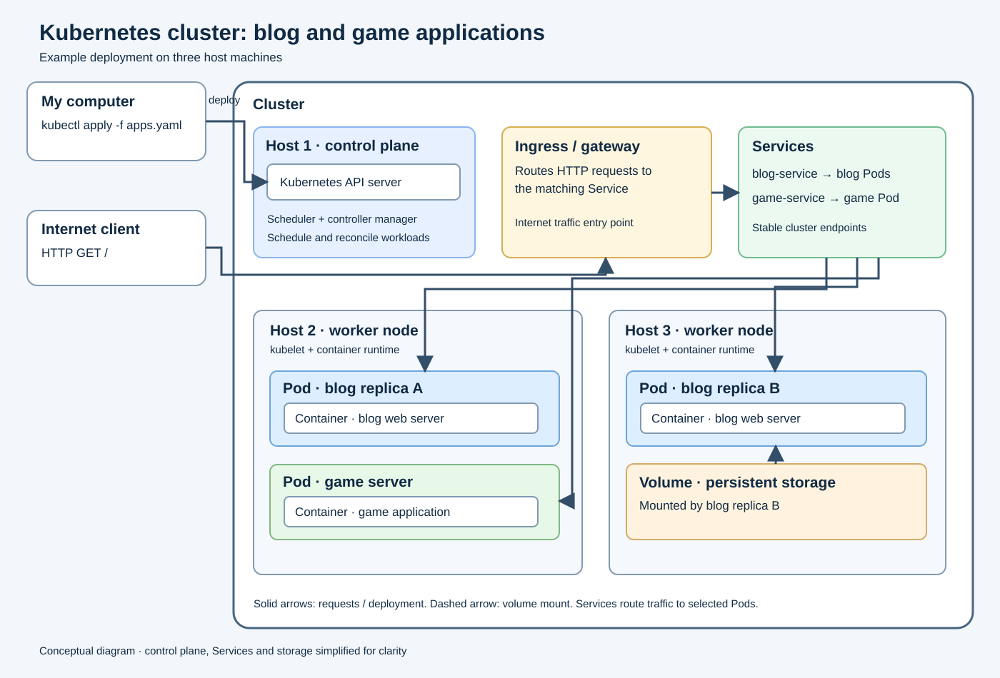

# Exercise 3.11: Kubernetes cluster diagram

The diagram shows kubectl sending the desired configuration to the API server.
The control plane schedules workloads on two worker nodes. An Internet client
reaches the blog through an ingress/gateway and a Service. Services select
Pods for the blog and game applications, and a persistent volume is mounted
by one blog Pod. This is a conceptual example; network and storage providers
supply the actual ingress and persistent storage implementation.

References: [Kubernetes cluster architecture](https://kubernetes.io/docs/concepts/architecture/),
[Services](https://kubernetes.io/docs/concepts/services-networking/service/),
and [persistent volumes](https://kubernetes.io/docs/concepts/storage/persistent-volumes/).
